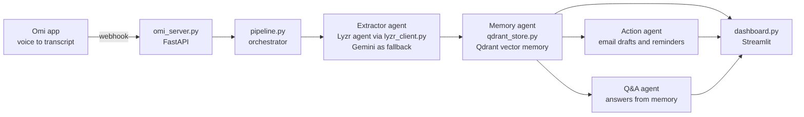

# 🎙️ Meeting-to-Action Agent

> An autonomous agent that listens to your real-world conversations, remembers the commitments in them, and acts on them without being prompted.

Built solo for the **Stop Prompting. Code Solo Agents** hackathon (Track 1: Meeting & Lecture Intelligence) using **Omi**, **Lyzr** and **Qdrant**.

---

## The Problem

We make promises in conversations every day ("I'll send you the doc by Friday"). Most are forgotten within hours because nobody writes them down.

## The Solution

Meeting-to-Action Agent turns spoken conversations into tracked commitments. Once a conversation ends, a small team of agents extracts the tasks, stores them as searchable vector memory, takes action on its own (follow-up email drafts and reminders), and lets you ask questions about past meetings.

---

## How It Works



1. **Capture (Omi):** The Omi app sends real-time transcript segments to a FastAPI webhook (`/webhook/transcript`). The server collects the segments and processes the conversation after 30 seconds of silence.
2. **Extract (Lyzr):** A Lyzr agent, called through its API, returns the action items as JSON: task, owner, person, deadline, type and priority. It ignores small talk and unclear speech. If Lyzr is unavailable, the pipeline falls back to Gemini so it keeps working.
3. **Remember (Qdrant):** Each task is embedded and stored in Qdrant. Near-duplicate tasks are merged, and related past tasks are recalled before every new one is stored.
4. **Act (autonomous):** The action agent drafts a follow-up email for every promise made to a named person and schedules a reminder log entry for tasks with a deadline. Nobody clicks anything.
5. **Ask (past-meeting Q&A):** Questions such as "What did I promise Rahul?" are answered from the stored memory.
6. **Observe:** A Streamlit dashboard shows every agent step (and whether Lyzr or the fallback did the extraction), the stored memory, the actions taken, and the Q&A box.

---

## Tech Stack

| Layer | Tool |
|---|---|
| Voice input | [Omi](https://www.omi.me/) (mobile app, real-time transcript webhook) |
| Agent framework | [Lyzr](https://www.lyzr.ai/) (extractor agent, called by API) |
| Vector memory | [Qdrant](https://qdrant.tech/) |
| LLM and embeddings | Google Gemini (fallback extraction, Q&A, embeddings) |
| Backend | Python, FastAPI |
| UI | Streamlit |

---

## Project Structure

```
meeting-agent/
├── omi_server.py         # FastAPI webhook that receives Omi transcripts
├── pipeline.py           # Orchestrator: extract -> remember -> act, plus Q&A
├── extract.py            # Extraction: Lyzr first, Gemini fallback
├── lyzr_client.py        # Lyzr agent API client
├── qdrant_store.py       # Qdrant collection, embeddings, duplicate check, recall
├── dashboard.py          # Streamlit dashboard
├── reset_memory.py       # Utility: deletes the Qdrant collection
├── sample_transcript.txt # Demo input for testing without voice
├── requirements.txt
├── .env.example
└── .gitignore
```

An `outputs/` folder (agent log, email drafts, raw Omi payloads) is created at runtime and is git-ignored.

---

## Setup

Requires Python 3.10+, a Qdrant Cloud cluster, a Gemini API key, a Lyzr agent with its API key, and the Omi mobile app.

### 1. Clone

```bash
git clone https://github.com/sunnysavarna108-commits/meeting-agent.git
cd meeting-agent
```

### 2. Create a virtual environment

```bash
python -m venv venv
# Windows
venv\Scripts\activate
# macOS / Linux
source venv/bin/activate
```

### 3. Install dependencies

```bash
pip install -r requirements.txt
```

### 4. Add your API keys

```bash
cp .env.example .env      # Windows: copy .env.example .env
```

Fill in `.env`:

```
GEMINI_API_KEY=
QDRANT_URL=
QDRANT_API_KEY=
LYZR_API_KEY=
LYZR_AGENT_ID=
```

> ⚠️ Never commit `.env`. It is listed in `.gitignore`.

### 5. Create the Lyzr agent

In Lyzr Studio, create an agent whose instructions are the `PROMPT` text in `extract.py` (return a JSON list of action items, or `[]` if there are none). Copy its Agent ID and API key into `.env`.

---

## Running the Project

**Quick test with a sample transcript (no voice needed):**

```bash
python pipeline.py
```

**Start the Omi webhook server:**

```bash
python -m uvicorn omi_server:app --port 8000
```

**Expose it publicly (for Omi), in a second terminal:**

```bash
ngrok http 8000
```

In the Omi app go to **Settings → Developer Mode → Developer Settings** and set **Real-Time Transcript Webhook** to:

```
https://YOUR-NGROK-DOMAIN/webhook/transcript
```

Speak, then stay quiet for about 30 seconds. The server processes the conversation as a whole.

**Launch the dashboard, in a third terminal:**

```bash
python -m streamlit run dashboard.py
```

**Reset memory (clears the Qdrant collection):**

```bash
python reset_memory.py
```

---

## Demo

1. A conversation is spoken into the Omi app.
2. The webhook receives the transcript; the Lyzr agent extracts commitments and deadlines.
3. Tasks are written to Qdrant, with related past items recalled.
4. The action agent drafts a follow-up email and logs reminders with no user prompt.
5. The dashboard shows each agent's steps, and the Q&A tab answers questions about past meetings.

🎥 **Demo video:** _add link here_

---

## Honest Notes and Limitations

- Voice input was tested with the **Omi mobile app** (phone microphone), not the wearable. The `/simulate` endpoint and the dashboard's transcript box accept plain text for testing.
- Follow-up emails are **drafted as text files** in `outputs/`, not sent. Reminders are **logged**, not yet created in a calendar.
- Transcript quality depends on Omi's speech recognition. The extractor ignores unclear speech, but clear English in a quiet room works best.
- **Privacy:** Omi sends everything it hears to the webhook. Raw payloads are saved under `outputs/` (git-ignored). Turn the webhook off when you are not testing.

---

## Roadmap

- Real calendar events and sent emails (Google Calendar and Gmail)
- Proactive reminders before deadlines
- Separate Lyzr agents for memory, actions and Q&A
- Cross-meeting insights ("you promised Rahul a doc last week")

---

## Author

**Sunny Choudhary**: [@sunnysavarna108-commits](https://github.com/sunnysavarna108-commits)

## License

MIT
