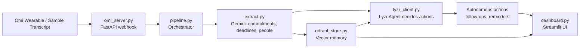

# 🎙️ Meeting-to-Action Agent

> An autonomous agent that listens to your real-world conversations, remembers them, and acts on the commitments hidden inside — without being prompted.

Built solo for the **Solo AI Agents Hackathon** using **Omi**, **Lyzr** and **Qdrant**.

---

## The Problem

We make promises in meetings and conversations every day ("I'll send you the doc by Friday"). Most are forgotten within hours because nobody writes them down.

## The Solution

**Meeting-to-Action Agent** captures conversations, extracts commitments and deadlines, stores them as searchable memory, and then **acts on its own**: drafting follow-ups, creating reminders and surfacing past promises.

---

## How It Works



1. **Capture**: Omi sends conversation transcripts to a FastAPI webhook (or you feed in a sample transcript).
2. **Extract**: Gemini pulls out action items, owners, people and deadlines.
3. **Remember**: Every conversation and commitment is embedded and stored in **Qdrant**.
4. **Decide and Act**: A **Lyzr** agent retrieves relevant past context and autonomously decides what to do next.
5. **Review**: A dashboard shows captured meetings, extracted tasks and agent actions.

---

## Tech Stack

| Layer | Tool |
|---|---|
| Agent framework | [Lyzr](https://www.lyzr.ai/) |
| Vector memory | [Qdrant](https://qdrant.tech/) |
| Real-world input | [Omi](https://www.omi.me/) |
| LLM | Google Gemini |
| Backend | Python, FastAPI |
| UI | Streamlit |

---

## Project Structure

```
meeting-agent/
├── omi_server.py        # FastAPI webhook that receives Omi transcripts
├── pipeline.py          # Main flow: transcript → extract → store → act
├── extract.py           # LLM extraction of commitments and deadlines
├── lyzr_client.py       # Lyzr agent client
├── qdrant_store.py      # Qdrant collection, embeddings, search
├── dashboard.py         # Streamlit dashboard
├── reset_memory.py      # Utility: deletes the Qdrant collection
├── sample_transcript.txt# Demo input (no Omi device needed)
├── requirements.txt
├── .env.example
└── .gitignore
```

---

## Setup

### 1. Clone

```bash
git clone https://github.com/sunnysavarna108-commits/meeting-agent.git
cd meeting-agent
```

### 2. Create a virtual environment

```bash
python -m venv venv
# Windows
venv\Scripts\activate
# macOS / Linux
source venv/bin/activate
```

### 3. Install dependencies

```bash
pip install -r requirements.txt
```

### 4. Add your API keys

Copy the template and fill in your own values:

```bash
cp .env.example .env      # Windows: copy .env.example .env
```

```
GEMINI_API_KEY=
QDRANT_URL=
QDRANT_API_KEY=
LYZR_API_KEY=
LYZR_AGENT_ID=
```

> ⚠️ Never commit `.env`. It is already listed in `.gitignore`.

---

## Running the Project

**Process a sample transcript (no hardware needed):**

```bash
python pipeline.py
```

**Start the Omi webhook server:**

```bash
uvicorn omi_server:app --reload --port 8000
```

Point your Omi app's transcript webhook to your server URL (use a tunnel such as ngrok for local testing).

**Launch the dashboard:**

```bash
streamlit run dashboard.py
```

**Reset memory (clears the Qdrant collection):**

```bash
python reset_memory.py
```

---

## Demo

1. A conversation is captured (live via Omi, or from `sample_transcript.txt`).
2. The agent extracts commitments and deadlines automatically.
3. Memory is written to Qdrant.
4. The agent takes action **without any user prompt**.
5. The dashboard shows what was captured and what the agent did.

🎥 **Demo video:** _add link here_

---

## Why It Fits the Hackathon

- **Autonomy**: the agent acts on its own after a conversation ends.
- **Memory**: Qdrant lets it recall promises from past conversations.
- **Real-world input**: Omi brings in live, spoken context.

---

## Roadmap

- Calendar event creation
- Email and Slack integrations
- Proactive reminders before deadlines
- Cross-meeting insights ("you promised Rahul a doc last week")

---

## Author

**Sunny Savarna**: [@sunnysavarna108-commits](https://github.com/sunnysavarna108-commits)

## License

MIT
